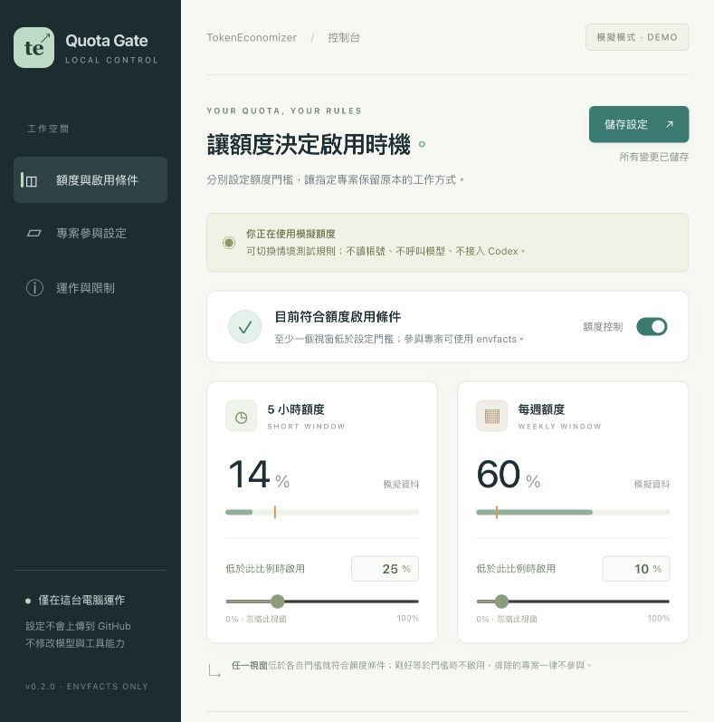
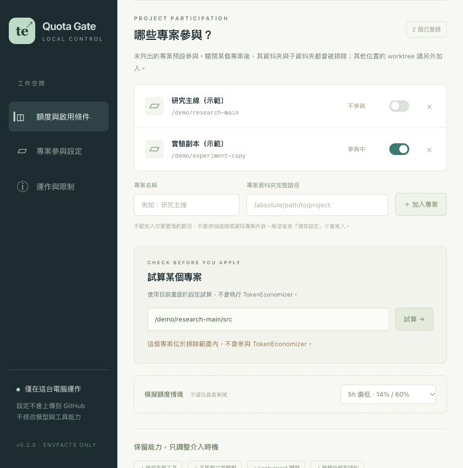

# Codex TE Quota Gate

[English](#english) | [繁體中文](#zh-tw)

<a id="english"></a>

## English

### Overview

Codex TE Quota Gate adds local quota controls to
[Microsoft TokenEconomizer](https://github.com/microsoft/TokenEconomizer). It allows only
TokenEconomizer's **`envfacts`** when either the **5-hour** or **weekly** Codex quota falls
below its own configurable remaining-percentage threshold (default: 15% each).
You can exclude project folders and adjust the rules through a local browser GUI.
All tools remain available, and the loop guard stays off.

**Status: executable prototype; local installation and live quota reads verified.**
The GUI, shared settings, policy, subprocess protocol and generated hook bridge have been
tested. The bundled Codex CLI discovers all five hooks without load errors or timeout warnings.
The five local hooks are trusted. Execution in the existing desktop conversation, quota savings
and answer-quality equivalence have not been established. This project is independent of Microsoft and OpenAI.
It does not change your main model, install plugins automatically, or approve hooks for you.

### v0.3.1: evidence-based status and a dismissible panel

The menu-bar panel now has a bounded scroll area, a persistent close button, **Esc / Cmd+W**
to dismiss it, and **Cmd+Q** to quit. The menu-bar label and panel distinguish a skipped hook,
a successful upstream call without context, returned context, failure, and no observations.
The status describes the latest recorded event across projects; the quota condition is shown
separately. No observations mean **unknown**, not confirmed inactivity or success.

Normal callbacks write `hook-activity.json`. Explicit diagnostics use a separate
`diagnostic-hook-activity.json`, so test events cannot inflate normal execution counts.
The app writes only UI visibility metadata to `menu-ui-health.json` for local close/quit QA.
A changed hook definition may require review; the local v0.3.1 upgrade retained the five
already-trusted definitions without writing new trust entries.

Two optional diagnostics are available: `scripts/check_codex_runtime.py` (Python 3.11+)
uses the actual installed, trusted Codex hooks with an ephemeral CLI turn against a loopback
canned response; `scripts/check_upstream_hook.py` uses the pinned upstream bootstrap and
isolated synthetic quota/context files. Neither calls a paid model, changes real thresholds,
or establishes execution in an existing desktop conversation. The runtime check refuses to
run untrusted hooks. An existing conversation may need to be reopened or a new conversation
started to load a plugin installed after that conversation began.

### v0.3.0: native macOS menu bar and local execution receipts

The native **TE Quota Bar** shows separate 5-hour/weekly rings, reset times, live hook trust,
quota eligibility, and the last observed hook, upstream forwarding and emitted context.
**Eligible does not mean running. Forwarded does not mean context was available. Context
returned does not prove that the host consumed it or that quota was saved.**

```bash
python3 scripts/build_macos.py --output "/absolute/path/TE Quota Bar.app"
```

Build on macOS 13+ with Xcode command-line tools and the Python environment used by this
project. The local build records that Python executable; Python is not embedded. On this
installation the app uses `~/Library/Application Support/TE Quota Gate/runtime/` and the
bundled Codex CLI in `/Applications/ChatGPT.app`. Launch the app, then click **TE** in the
menu bar. The initial status window can be closed while the menu-bar item stays available.
The app refreshes local display data every 3 seconds and read-only Codex diagnostics about
every 60 seconds. It reuses fresh quota snapshots and an existing GUI on port 8766, or starts
its own reader/GUI. Closing the app stops its monitor; independently started readers/GUI remain.
It adds no login item, model call or permission approval.

To observe executions, rebuild/reinstall the v0.3.0 plugin bundle as well as the app, and review
its updated hooks. Existing v0.2.x hooks do not write receipts. Each new hook records only
allowlisted event name, time, result, duration and whether context was returned. The bounded
`hook-activity.json` retains 40 recent receipts and cumulative recorded counts; it contains
no prompt, answer, injected content, session ID or project path. Recording is best effort and
never blocks the hook; missing receipts mean unknown, rather than proof that no hook ran.
Old receipts cannot be reconstructed. Settings and project exclusions survive the update.
For an existing local installation, explicitly run `python3 scripts/upgrade_local.py` when
ready to review the updated hooks; opening the menu-bar app alone never upgrades them.
The bridge also accepts upstream JSON progress lines before its final hook result.

### v0.2.1: SessionEnd compatibility fix

The generated SessionEnd hook uses Codex's 3-second limit, with a 2-second upstream execution
budget. Other hooks retain their 15-second host limit. Rebuild and reinstall an existing
local bundle, then review its hooks again. Shared thresholds and project exclusions are preserved.

### v0.2.0: GUI, separate thresholds and project exclusions

```bash
python3 -m quota_gate gui --demo --open
```

On macOS, you can also double-click **`launch_demo.command`** in the project root.
For regular local settings, run `python3 -m quota_gate gui --open` or double-click
**`launch_gui.command`**. Python 3.10+ must already be installed; the launchers do not
install software. The GUI binds only to `127.0.0.1`. It does not create a public website,
connect an account, start the quota reader automatically, or install the plugin.



- Set each threshold independently from **0–100%**, using a number field or slider.
  Zero disables triggering from that window.
- The rule is **OR**: either remaining percentage must be strictly below its own threshold.
  Equality does not trigger activation.
- Add an absolute project-folder path and toggle participation. Newly added projects are
  excluded by default; save the settings to apply the change.
- An excluded folder also excludes its descendants. Canonical-path matching avoids excluding
  unrelated folders with a similar name prefix.
- Unlisted projects participate by default. Clones or worktrees at other paths need separate entries.
- The project preview evaluates the current, possibly unsaved settings **without running TokenEconomizer**.
- Saving writes the shared settings file. Each subsequent hook reads it again; no bundle rebuild is needed.
- The GUI does not scan project files. Settings stay local, and `runtime/` is ignored by git.



Regular mode uses `runtime/settings.json` and `runtime/quota.json` by default. Demo mode uses
the separate `runtime/demo/` directory. **Demo settings are not applied to regular mode.**
If your existing bundle uses other runtime paths, pass the same files through `--settings`
and `--snapshot` when launching the regular GUI.

The table below uses the default thresholds of 15% / 15%. Custom thresholds are evaluated independently.

| 5-hour remaining | Weekly remaining | Action |
|---:|---:|---|
| 40% | 60% | Do not call the TokenEconomizer hook |
| 14% | 60% | Allow `envfacts` |
| 40% | 14% | Allow `envfacts` |
| 15% | 15% | Do not call the TokenEconomizer hook |
| Stale data, a missing window, or a reset requiring a fresh read | — | Do not call the TokenEconomizer hook |

The wrapper forces `microskills=envfacts`, `toolprune=off`, `loopguard=off` and `repomap=off`.
It uses a dedicated upstream state directory to avoid mixing in facts learned by a separate
TokenEconomizer installation. These choices reduce ways the plugin can affect capabilities;
**they do not prove identical answer quality or guarantee quota savings**.

### Try the offline demo first

Python 3.10+ and the standard library are sufficient. Run from the project root; no pip installation is needed.

```bash
python3 -m quota_gate demo
python3 -m unittest discover -s tests -v
```

These commands use synthetic data and temporary directories. They do not log in, read personal
conversations, call a model, or install a plugin. See the [example output](docs/demo.txt).

### Architecture

```text
Codex app-server: account/rateLimits/read
       │  local quota reader, every 60 seconds by default; no thread/turn creation
       ▼
runtime/quota.json       (timestamps, billing bucket and quota windows only)
runtime/settings.json    (thresholds and project participation shared by GUI / CLI / hooks)
       │
Codex hook → gate → project allowed, either quota below its threshold, and valid data?
                       ├─ no  → {}
                       └─ yes → pinned TokenEconomizer bootstrap
                               envfacts only / dedicated state
```

Windows are identified by `windowDurationMins=300 / 10080`; the reader does not assume that
`primary` is the 5-hour window. It prefers `rateLimitsByLimitId.codex` to avoid mixing other
model or plan buckets. Some plans return only a weekly window; this version stays inactive
instead of guessing what the missing window means.

### Connect real hooks only after reviewing the prototype

The collector and generated shell hooks currently support macOS/Linux. Integration requires
a working Codex CLI signed in to an existing ChatGPT account, and manual hook review/trust.
No API key is required. Whether the desktop app loads the same plugin/hook environment must
be checked on the target version.

#### 1. Read quotas without connecting the plugin

Confirm that `codex` runs. If it is not on PATH, provide the verified CLI's absolute path.
This tool does not download the CLI, locate credentials, log in, refresh login, or switch accounts.

```bash
python3 -m quota_gate capture --codex /absolute/path/to/codex --output runtime/quota.json
python3 -m quota_gate evaluate --snapshot runtime/quota.json --settings runtime/settings.json --project /absolute/path/to/project
```

`capture` sends only `initialize`, `initialized` and `account/rateLimits/read`. Server-initiated
requests receive an unsupported-action response; the reader does not approve permissions,
purchase credits, or consume quota resets. A failed read invalidates the snapshot.
Its stdout shows quota eligibility under the default thresholds, not the raw account response.
For custom thresholds/projects, use the GUI or `evaluate` with `--settings` and `--project`.
Save settings in the GUI, or let `build` create the defaults, before running that `evaluate` command.

#### 2. Get the reviewed upstream revision and generate a local marketplace

```bash
git clone https://github.com/microsoft/TokenEconomizer.git ../TokenEconomizer
git -C ../TokenEconomizer checkout --detach e428fc91b0f8ffecb5a596d56b14fe2f1485a5f9
python3 scripts/check_upstream.py --source ../TokenEconomizer
python3 -m quota_gate build --source ../TokenEconomizer --output local-marketplace --snapshot runtime/quota.json --settings runtime/settings.json
```

`build` requires a clean upstream checkout at the specified commit and generates hooks,
manifests and local path settings in a new directory. **It does not install anything, change
Codex config, or approve hooks.** Each generated-hook invocation compares the upstream Python
source SHA-256 hashes and stops forwarding if files were added, removed or changed.
This guards against unreviewed updates; it is not a security certification of unknown code.
Keep the upstream clone and the selected Python executable at their configured locations.

#### 3. Review and connect manually

Read [integration and rollback](docs/INTEGRATION.md), especially the standalone upstream plugin
and existing deny-list notes. After reviewing the generated
`local-marketplace/plugin/hooks/codex-hooks.json`, use:

```bash
codex plugin marketplace add "$PWD/local-marketplace"
codex plugin add te-quota-gate@te-quota-gate
```

Review and trust the hook yourself when Codex asks; this tool does not approve it for you.
Keep the quota reader running in another terminal:

```bash
python3 -m quota_gate watch --codex /absolute/path/to/codex --output runtime/quota.json
```

Ctrl+C stops the reader and invalidates the snapshot. No launchd job, scheduled task or
persistent background service is configured. After a crash, snapshots expire within 90 seconds;
a snapshot whose `resetsAt` has passed expires immediately. With the default 60-second refresh,
crossing a threshold is detected at a subsequent refresh and hook invocation, not instantly.

### Capability tradeoffs and limitations

- Does not disable image viewing, subagents, the web or other tools, or change the main model/reasoning effort.
- `envfacts` can still inject outdated operational advice. Zero quality loss has not been proven.
- The wrapper and selected conservative profile do not initiate model calls, but injected text
  still becomes part of later model input.
- When quotas are sufficient, upstream hooks are not forwarded. The gate and quota reader still run.
- Previously injected text remains in conversation history after quotas recover. Start a new
  conversation if you need context without those facts.
- An allowed upstream hook can start a detached fold; quota recovery does not terminate work already started.
- Facts are mainly injected at an eligible SessionStart. Crossing the threshold mid-session
  can allow later hooks, but does not guarantee immediate fact injection or savings.
- Does not change or restore tool deny lists left by a previous standalone TokenEconomizer installation.
- Project exclusions match each hook's `cwd`. They do not erase learned state, retract context,
  or stop existing folds. Keep one project per conversation; this is not a redaction or privacy-isolation
  tool for mixed-project transcripts.
- The full distiller and loop guard stay disabled. The upstream 18–31% cost-reduction claim
  should not be applied to this conservative profile.
- Both quota windows must be valid. Unknown data, the wrong bucket, invalid numbers, stale data
  and read failures keep forwarding inactive.
- Only the selected `codex` bucket is managed. Before switching account/workspace/billing bucket,
  stop the reader, remove the snapshot and restart in the matching target environment.
  Do not share runtime data between accounts.
- Does not bypass exhausted subscription limits, replenish quota or enable automatic payment.

### Validation, references and license

See the [validation report](docs/VALIDATION.md) and [data flow and permissions](docs/PRIVACY.md).
CI runs offline tests without accounts, secrets or model fees. Existing v0.1.0 users should read
[the upgrade instructions](docs/INTEGRATION.md#upgrading-from-v010): an already-copied old bundle
does not automatically gain GUI settings support.

- [OpenAI app-server: initialization and quota reads](https://learn.chatgpt.com/docs/app-server)
- [OpenAI hooks: user review and trust](https://learn.chatgpt.com/docs/hooks)
- [TokenEconomizer configuration and uninstall instructions](https://github.com/microsoft/TokenEconomizer/blob/e428fc91b0f8ffecb5a596d56b14fe2f1485a5f9/plugin/README.md)
- [TokenEconomizer hook dispatcher](https://github.com/microsoft/TokenEconomizer/blob/e428fc91b0f8ffecb5a596d56b14fe2f1485a5f9/tokeneconomizer/plugin/hook.py)

This wrapper uses the MIT license. Upstream TokenEconomizer remains under its own Apache-2.0
license; its implementation is not redistributed here.


---

<a id="zh-tw"></a>

## 繁體中文

**狀態：可執行原型，已驗證本機安裝與真實額度讀取。**
本機 GUI、共用設定、判斷邏輯、子程序通訊與產生的 hook 包裝層已測試；
內附 Codex CLI 能找到全部五個 hooks，沒有載入錯誤或逾時警告。
本機五個 hooks 已受信任；既有桌面對話的實際執行、額度節省與回答品質等同尚未確立。
本專案獨立於 Microsoft 與 OpenAI。

### 這是什麼？

這個本機工具替 [Microsoft TokenEconomizer](https://github.com/microsoft/TokenEconomizer)
加上額度門檻。它不會更換你的主要模型，也不會自動安裝或核准任何插件。

### v0.3.1：以紀錄判斷介入，並修正面板關閉

Menu bar 面板已限制高度並可捲動，固定保留關閉按鈕；**Esc／Cmd+W** 關閉面板，
**Cmd+Q** 結束程式。選單列與面板區分「已跳過」、「已呼叫但無注入內容」、
「已回傳內容」、「失敗」與「尚無觀測」。狀態描述所有專案中最後一筆已記錄事件，
額度資格另外顯示。沒有紀錄表示**未知**，不能當成已介入或確定沒有執行。

日常事件寫入 `hook-activity.json`；明確標記的診斷使用獨立的
`diagnostic-hook-activity.json`，不會增加日常介入次數。App 只將視窗可見性等 UI
驗證資料寫入本機 `menu-ui-health.json`。hook 定義改變時可能需要重新審核；本機
v0.3.1 升級保留了五個已信任定義，沒有寫入新的信任紀錄。

提供兩個可選診斷：`scripts/check_codex_runtime.py`（Python 3.11 以上）使用實際已安裝、
受信任的 Codex hooks，以短暫 CLI 工作階段連到本機固定回應；
`scripts/check_upstream_hook.py` 使用固定版本的上游 bootstrap 與隔離的模擬額度／內容。
兩者都不呼叫付費模型、不改真實門檻，也不能證明既有桌面對話已經介入。前者會拒絕
執行未受信任的 hooks。若外掛是在對話開始後才安裝，既有對話可能需要重新開啟，
或在新對話中載入更新。

### v0.3.0：原生 macOS Menu bar 與本機執行紀錄

原生 **TE Quota Bar** 顯示 5 小時／每週額度環、重置時間、hooks 信任狀態、額度資格，
以及最後一次觀測到 hook、轉交上游、回傳注入內容的時間。
**符合條件不代表正在執行；轉交不代表有內容可注入；回傳內容也不能證明主程式已採用，
更不能據此宣稱已節省額度。**

```bash
python3 scripts/build_macos.py --output "/absolute/path/TE Quota Bar.app"
```

以 macOS 13 以上、Xcode command-line tools 及本專案的 Python 環境建置。
本機版本會記住建置時的 Python 路徑，沒有內嵌 Python。此安裝使用
`~/Library/Application Support/TE Quota Gate/runtime/` 與 `/Applications/ChatGPT.app`
內附的 Codex CLI。開啟 App 後點上方選單列的 **TE**；初始狀態視窗可關閉，Menu bar
圖示仍會保留。畫面每 3 秒更新，約每 60 秒執行唯讀 Codex 狀態查詢；會沿用新鮮額度
快照與 8766 埠的既有 GUI，或自行啟動讀取／GUI。結束 App 會停止它的監測器；獨立啟動
的讀取器和 GUI 不受影響。不加入登入項目、不發起模型呼叫、不代為核准權限。

要觀察實際執行，需要連同 App 重新建置／安裝 v0.3.0 的 plugin bundle，並審核更新的
hooks。v0.2.x 的 hooks 不寫入紀錄。新 hooks 只記錄允許的事件名、時間、結果、耗時與
是否回傳內容。`hook-activity.json` 最多保留 40 筆近期紀錄及已記錄的累計次數，不含
提示詞、回答、注入內容、session ID 或專案路徑。寫入採盡力方式且不阻擋 hook，因此
沒有紀錄表示未知，不能據此證明從未執行。舊紀錄無法回補。更新會保留門檻及專案排除
設定。既有本機安裝可在準備好重新審核時，手動執行 `python3 scripts/upgrade_local.py`；
只開啟 Menu bar App 不會升級 hooks。包裝層也已支援上游先輸出 JSON 進度訊息、再輸出正式結果的情況。

### v0.2.1：SessionEnd 相容性修正

產生的 SessionEnd hook 使用 Codex 的 3 秒限制，上游執行預算為 2 秒；其他 hooks 維持
15 秒的主程式限制。既有本機套件需要重新建置、安裝並審核 hooks。共用的額度門檻與專案
排除設定會保留。

### v0.2.0：GUI、兩個獨立門檻與專案排除

```bash
python3 -m quota_gate gui --demo --open
```

macOS 也可雙擊專案根目錄的 **`launch_demo.command`**。正式本機設定介面使用
`python3 -m quota_gate gui --open`，或雙擊 **`launch_gui.command`**。
需要已安裝的 Python 3.10+；啟動器不會安裝軟體。GUI 僅綁定 `127.0.0.1`，
不建立公網網站、不接入帳號、不自動啟動 quota reader，也不安裝插件。


- 兩個門檻可各自用數字或滑桿設定 **0–100%**；0 表示不使用該視窗觸發。
- 仍採 **OR**：任一剩餘比例嚴格低於對應門檻就符合條件；等於門檻不觸發。
- 手動加入專案完整路徑，切換參與開關。新增專案預設不參與，須儲存才生效。
- 排除涵蓋該路徑與子資料夾，使用正規化路徑比對；相似前綴資料夾不會被誤排除。
- 未列出的專案預設參與；其他位置的 clone/worktree 必須另外加入。
- 「試算某個專案」使用尚未儲存的畫面設定，**不執行 TokenEconomizer**。
- 「儲存設定」會寫入共用設定檔，之後每次 hook 都重新讀取，不必重建 bundle。
- GUI 不會掃描專案檔案。設定存在本機，`runtime/` 已由 git 排除。


預設一般模式共用 `runtime/settings.json` 與 `runtime/quota.json`；demo 使用
獨立的 `runtime/demo/`。**Demo 的設定不會偷偷套用到一般模式。**
若你的既有 bundle 使用其他 runtime，使用 `--settings` 與 `--snapshot` 指向相同檔案。

以下是預設 15% / 15% 的行為；調整門檻後會依各自的新門檻判斷：

| 5 小時剩餘 | 每週剩餘 | 行為 |
|---:|---:|---|
| 40% | 60% | 不呼叫 TokenEconomizer hook |
| 14% | 60% | 允許 `envfacts` |
| 40% | 14% | 允許 `envfacts` |
| 15% | 15% | 不呼叫 TokenEconomizer hook |
| 資料過期、缺少一個視窗、額度已重設但未重讀 | — | 不呼叫 TokenEconomizer hook |

預設強制 `microskills=envfacts`、`toolprune=off`、`loopguard=off`、`repomap=off`。
插件資料使用獨立目錄，避免混入另一套 TokenEconomizer 先前學到的內容。
這減少能力受影響的途徑，**不代表已證明品質完全相同，也不保證可以省多少額度**。

### 先看離線展示

Python 3.10+，只有標準函式庫。從此專案根目錄執行，無需 pip 安裝：

```bash
python3 -m quota_gate demo
python3 -m unittest discover -s tests -v
```

這兩個命令使用合成資料和臨時目錄，不登入、不讀取個人對話、不呼叫模型，
也不安裝插件。範例輸出見 [離線展示](docs/demo.txt)。

### 運作架構

```text
Codex app-server: account/rateLimits/read
       │  本機 quota reader，預設每 60 秒一次；不建立 thread/turn
       ▼
runtime/quota.json（只保存時間、bucket 和額度視窗）
runtime/settings.json（GUI / CLI / hook 共用的獨立門檻與專案參與設定）
       │
Codex hook → gate → 此專案未排除，且任一剩餘低於對應門檻，且資料有效？
                       ├─ 否 → {}
                       └─ 是 → pinned TokenEconomizer bootstrap
                               envfacts only / dedicated state
```

辨識視窗使用 `windowDurationMins=300 / 10080`，不假設 primary 一定是 5 小時。
優先使用 `rateLimitsByLimitId.codex`，避免混用其他模型或方案的 bucket。
某些方案只回傳 weekly；本版會停用，**不猜測缺失視窗的意思**。

### 在你看過原型後，才進行實際整合

目前 collector 與產生的 shell hook 限 macOS/Linux。實際整合需要可用的 Codex CLI
（登入既有 ChatGPT 帳號）以及你手動信任 hook。不需要 API key。
桌面 App 是否載入同一個插件／hook 環境，必須在目標版本另外確認。

#### 1. 只讀取額度，尚不接入插件

先確認 `codex` 可執行。若它不在 PATH，使用你確認過的 CLI 完整路徑；本工具不會
自行下載 CLI、尋找登入憑證、登入、刷新登入或更換帳號。

```bash
python3 -m quota_gate capture --codex /absolute/path/to/codex --output runtime/quota.json
python3 -m quota_gate evaluate --snapshot runtime/quota.json --settings runtime/settings.json --project /absolute/path/to/project
```

`capture` 只送出 `initialize`、`initialized` 和 `account/rateLimits/read`。
任何 server-initiated 請求都回覆不支援，不會核准權限、購買 credits 或消耗重設次數。
失敗時立即覆寫成無效快照。stdout 顯示預設門檻的額度判斷，不輸出原始帳號回應；
已自訂門檻／專案時以 GUI 或帶 `--settings --project` 的 `evaluate` 為準。
先開 GUI 儲存設定，或由 `build` 建立預設設定後，再執行上面的 `evaluate`。

#### 2. 取得經查核的上游版本，產生可審閱的本機 marketplace

```bash
git clone https://github.com/microsoft/TokenEconomizer.git ../TokenEconomizer
git -C ../TokenEconomizer checkout --detach e428fc91b0f8ffecb5a596d56b14fe2f1485a5f9
python3 scripts/check_upstream.py --source ../TokenEconomizer
python3 -m quota_gate build --source ../TokenEconomizer --output local-marketplace --snapshot runtime/quota.json --settings runtime/settings.json
```

`build` 要求乾淨、符合指定 commit 的上游 checkout，並在新目錄產生 hooks、manifest
和本機路徑設定。**它不安裝、不修改 Codex config、不核准 hook**。每次執行產生的
hook，都會比對上游 Python 程式的 SHA-256；上游新增、刪除或修改程式時停止轉交。
這是更新防護，不是對未知上游程式的安全認證。保留上游 clone 和所用 Python 的位置。

#### 3. 手動檢閱並接入

先閱讀 [整合與回復說明](docs/INTEGRATION.md)，尤其是獨立原版插件與既有 deny list。
確認產生的 `local-marketplace/plugin/hooks/codex-hooks.json` 後，才使用：

```bash
codex plugin marketplace add "$PWD/local-marketplace"
codex plugin add te-quota-gate@te-quota-gate
```

Codex 要求時由使用者審閱並信任這個 hook。此工具不代為核准。
接著在另一個終端機保持額度 reader 執行：

```bash
python3 -m quota_gate watch --codex /absolute/path/to/codex --output runtime/quota.json
```

Ctrl+C 停止 reader，並使快照無效。不設定 launchd、排程工作或背景常駐。
崩潰時，快照最晚在 90 秒後失效；已到 `resetsAt` 的快照立即失效。
預設 60 秒更新意味門檻跨越並非即時偵測，正常情況約在下一次更新與 hook 時點生效。

### 能力代價與重要限制

- 不關閉圖片檢視、子代理、網路或其他工具，也不改主要模型／reasoning effort。
- `envfacts` 仍會把學到的操作經驗加入上下文，經驗可能過時；沒有「品質零損失」證明。
- 本工具和指定的保守功能不主動呼叫模型；注入的文字本身仍會成為日後模型輸入。
- 額度高時不轉交新的 upstream hooks，但 gate 本身仍需執行，reader 仍需讀額度。
- 已加入對話的文字不會在額度恢復後從歷史中消失。需要完全乾淨的上下文時開新對話。
- 上游可在有效的 hook 中啟動 detached fold；已啟動的工作不會因之後恢復額度而被終止。
- Facts 主要在有效的 SessionStart 注入。中途跌破門檻可以開始處理有效 hooks，
  但不保證當下立刻注入新經驗或節省額度；效果可能到之後的有效 session 才出現。
- 不修改／還原以前安裝的原版 TokenEconomizer 所留下的工具 deny list。
- 專案排除比對每次 hook 的 `cwd`，不會清除已學資料、撤回已注入內容或停止已啟動的 fold。
  請讓一段 Codex 對話專注在一個專案；這不是混合專案對話的內容刪除／隱私隔離工具。
- 不啟用完整 distiller 或 loop guard，不應套用上游宣稱的 18–31% 成本降幅。
- 兩個額度視窗都需有效；未知欄位、錯誤 bucket、非法數字、過期與讀取失敗皆停用。
- 此版本只管理指定 `codex` bucket。切換帳號／workspace／計費 bucket 時，
  先停止 reader 並移除快照，再以同一目標環境重新啟動；不跨帳號共用 runtime。
- 不對已耗盡的訂閱額度提供繞過、補充或自動付費方式。

### 驗證與來源

見 [驗證報告](docs/VALIDATION.md) 與 [資料流和權限](docs/PRIVACY.md)。
CI 僅執行離線測試，不需要帳號、密鑰或模型費用。v0.1.0 使用者請參考
[升級與共用設定說明](docs/INTEGRATION.md#upgrading-from-v010)；舊版已複製的 bundle 不會自動獲得 GUI 設定功能。

- [OpenAI app-server：初始化與額度讀取](https://learn.chatgpt.com/docs/app-server)
- [OpenAI hooks：由使用者檢閱／信任](https://learn.chatgpt.com/docs/hooks)
- [TokenEconomizer 設定與卸載](https://github.com/microsoft/TokenEconomizer/blob/e428fc91b0f8ffecb5a596d56b14fe2f1485a5f9/plugin/README.md)
- [TokenEconomizer hook dispatcher](https://github.com/microsoft/TokenEconomizer/blob/e428fc91b0f8ffecb5a596d56b14fe2f1485a5f9/tokeneconomizer/plugin/hook.py)

此包裝工具採用 MIT 授權。上游 TokenEconomizer 維持其 Apache-2.0 授權；
本專案不重新散布上游實作。
